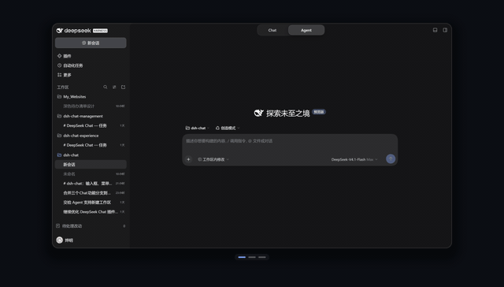

# DSHift

[](https://github.com/SamuelChung2010/DSHift/releases)
[](LICENSE)


[简体中文](README.md) | [English](README.en.md)

DSHift adds a native **DeepSeek Chat mode** to [DeepSeek Harness](https://github.com/deepseek-ai/deepseek-harness) (DSH), alongside Agent mode. Chat gets its own history, composer, model controls, and reasoning settings — and can hand a finished discussion to an Agent workspace without copying context by hand.

## Quick start

**Requirements**

- DeepSeek Harness `>=0.2.2-rc.5`
- A signed-in DeepSeek account or a DeepSeek API key
- Windows or macOS desktop; the Web UI is not yet verified

```sh
dsh plugin add github:SamuelChung2010/DSHift
```

You can also pick this repository directory from DSH **Plugins**, or install the `.tgz` from [Releases](https://github.com/SamuelChung2010/DSHift/releases). A `.zip` must be extracted and installed from the resulting directory.

Restart DSH or reload the plugin after installing the Host half; the browser side may ask for a refresh the first time.



## Core features

### Chat and Agent, side by side

A shared `Chat | Agent` switch changes the view without changing the window. Chat keeps its own conversations, search, drafts, and composer; Agent keeps its sessions and workspaces untouched. Chat appears on blank pages and steps aside once a conversation starts.

### Chat → Agent handoff

When the discussion is ready, click **Hand off to Agent**. DSHift turns it into an editable task brief, lets you pick or create a Harness workspace, then opens a real Agent session with that brief as the first prompt.

### Long-term memory and migration

Optional cross-conversation memory lives on your machine: automatic extraction, relevance-based injection, Memory Summary, Ask or Update, and imports from ChatGPT / Claude / Gemini. Memory is stored separately from chat history, and turning it off stops retrieval, injection, and extraction.

### DeepSeek chat import

Import an official DeepSeek App / web export ZIP locally. Titles, timestamps, thinking, search sources, answer branches, and recoverable images are preserved. Re-imports are deduplicated, and imported conversations can be continued or handed to an Agent.

## Other features

- **Web search and deep thinking**: independent composer toggles; answers carry numbered citations and a collapsible source list.
- **Attachments and images**: PDF / Word / PowerPoint parsing, image input, and `user_data` for text, code, spreadsheets, and ebooks.
- **Models and reasoning effort**: `deepseek-flash` / `deepseek-v4-pro`, with model and `Off / Low / High / Max` in one two-level menu, saved per conversation.
- **Conversation management**: folders, pinning, archive, history search, message editing, regeneration, answer versions, and continue-from-prefix.
- **Markdown / LaTeX / Mermaid**: highlighted and copyable code, formulas including `\boxed{}`, Mermaid diagrams; unsupported syntax falls back to source with an explanation.
- **Native-feeling interface**: English and Chinese, light and dark themes, responsive layout, and Windows / macOS styling.

## Beta 4 long-chat performance

Beta 4 rebuilds client subscriptions and render isolation: typing no longer re-renders historical messages, Markdown, or the sidebar, and streaming updates only the current answer. Measured on Windows 11, Intel Core Ultra 5 228V / 31.5 GB, Chrome 158 headless, the real DSH Web UI, with **synthetic conversations**:

| Scenario | Before P95 | After P95 |
| --- | --- | --- |
| 500 messages, dense Markdown | 118.3 ms | **14.5 ms** |
| 500 messages, regular content | 32.0 ms | **16.6 ms** |
| 300 messages, regular content | 22.2 ms | **8.2 ms** |

A normal keystroke now causes **zero** re-renders of historical messages, Markdown, or `renderBlocks`. P95 is the delay from the input event to a task after paint; these are local synthetic results and do not represent every user or macOS / Electron. See the [performance report](docs/perf/long-chat-performance.md) for method, raw data, and remaining bottlenecks.

## Usage and authentication

On a blank page, the shared `Chat | Agent` switch appears at the top. Chat needs authentication on first use: open **Chat settings → Authentication** and choose the DSH account or an API key. The default lookup order is:

1. API key saved in Chat settings (`DEEPSEEK_CHAT_API_KEY`)
2. `DEEPSEEK_API_KEY` from the DSH credential store or environment
3. The signed-in DeepSeek account token

API keys stay in the DSH Host process and are never sent to the browser. Enter sends, Shift + Enter inserts a newline, and the send key can be changed to Ctrl + Enter. Enter during an IME composition commits the candidate; it does not send.

See the [user guide](docs/user-guide.md) for everyday workflows and [configuration](docs/configuration.md) for authentication and options. The detailed guides are currently written in Chinese.

## Privacy, compatibility, and limitations

- Chat history, long-term memory, import staging, and imported images stay under `$DSH_HOME/deepseek-chat/`; import ZIPs are never uploaded. Chat, web search, file parsing, and memory extraction call the DeepSeek API on demand and may incur usage costs.
- DSHift is not an official DeepSeek product. It is verified on DSH `0.2.2-rc.5`; Windows and macOS desktop UI have been checked on real devices, the Web UI has not.
- Math support is a chat-focused LaTeX subset. Mermaid covers flowcharts, sequence diagrams, pie charts, and basic class diagrams; unsupported syntax falls back to source instead of failing.
- Stop a running answer before switching conversations or editing messages. `deepseek-v4-pro` does not support image understanding.
- The first mount of a 500-message dense conversation still takes about 3 seconds; that one-time cost is outside the typing path.

See [limitations](docs/limitations.md) for the full list and platform/test boundaries.

## Documentation

| Document | Contents |
| --- | --- |
| [User guide](docs/user-guide.md) | Chat, search, attachments, sessions, handoff, import, and memory workflows |
| [Architecture](docs/architecture.md) | Host / client split, state, streaming protocol, rendering, and import pipeline |
| [Configuration](docs/configuration.md) | Authentication, Host options, data storage, and model preferences |
| [Development](docs/development.md) | Build, tests, checks, performance benchmarking, and local install |
| [Limitations](docs/limitations.md) | Compatibility, feature boundaries, and performance test scope |
| [Memory integration](docs/memory-integration.md) | Imported-conversation and memory-extraction contract |
| [Performance report](docs/perf/long-chat-performance.md) | Beta 4 root causes, fix, and before/after data |
| [Changelog](CHANGELOG.md) | Release history with GitHub Releases links |

## Feedback, contributing, and license

- Questions and bugs: [GitHub Issues](https://github.com/SamuelChung2010/DSHift/issues)
- Contributing: see the [development guide](docs/development.md). Run the tests and checks before submitting, and never include real chat logs or secrets.
- Packages and checksums: [GitHub Releases](https://github.com/SamuelChung2010/DSHift/releases)

DSHift is released under the **MIT** license. See [LICENSE](LICENSE).
