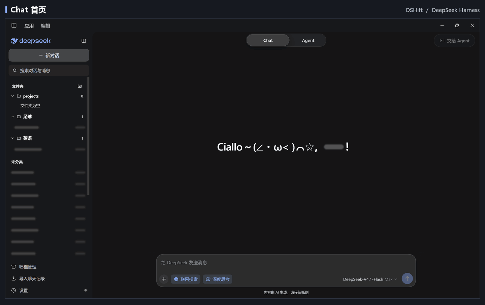

# DSHift

[](https://github.com/SamuelChung2010/DSHift/releases)
[](LICENSE)


**简体中文** | [English](README.en.md)

**从对话到行动，都在 DeepSeek Harness 内完成。**

DSHift 为 [DeepSeek Harness](https://github.com/deepseek-ai/deepseek-harness)（DSH）加入原生 **DeepSeek Chat 模式**，与 Agent 模式并列。你可以导入 DeepSeek 聊天记录、跨平台迁移长期记忆，并把讨论直接交给 Agent 执行。

## 快速开始

```sh
dsh plugin add github:SamuelChung2010/DSHift
```

**前置条件**

- DeepSeek Harness `>=0.2.2-rc.5`
- 已登录的 DeepSeek 账号，或可用的 DeepSeek API Key
- Windows 或 macOS 桌面端

也可以在 DSH 的 **Plugins** 页面选择本仓库目录，或安装 [Releases](https://github.com/SamuelChung2010/DSHift/releases) 中的 `.tgz`。`.zip` 需要先解压再从目录安装。

安装 Host 端后重启 DSH 或重载插件；浏览器端首次可能提示刷新。



## 核心特色

### Chat 与 Agent 双模式

使用顶部的 `Chat | Agent` 切换器，可以在同一窗口内切换两套独立界面。Chat 有自己的会话、搜索、草稿与输入框，Agent 有自己的会话和工作区。切换时会保留未发送的内容。切换器仅在空白页显示。进入已有会话或发送第一条消息后，只有切换器会自动隐藏，返回空白页时会重新显示。

### Chat → Agent 任务交接

在 Chat 里讨论完需求，点击「交给 Agent」。DSHift 会把对话整理成可编辑的任务说明，选择或新建 Harness 工作区后创建真实 Agent 会话，并把说明作为首条提示提交。不需要手工复制上下文。

### 长期记忆与跨平台迁移

跨会话记忆与聊天记录分开保存在本机。长期记忆默认开启，**自动提取默认关闭**，可在 **Chat 设置 → 长期记忆** 中按需开启自动提取。支持按问题相关度注入记忆、Memory Summary、Ask or Update，以及从 ChatGPT / Claude / Gemini 导入已有记忆。关闭长期记忆总开关后，检索、注入和自动提取全部停止。

### DeepSeek 聊天记录导入

读取 DeepSeek App / 网页版导出的官方 ZIP，在本机解析、预览并选择会话导入。标题、时间、思考过程、搜索来源、分支版本、可恢复图片都会保留；重复导入自动去重，导入的会话可以继续聊天或交给 Agent。

## 其他功能

- **联网搜索与深度思考**：输入框下方的独立开关；搜索回答带正文引用编号和可折叠来源列表。
- **附件与图片**：PDF / Word / PPT 走版面解析，图片可作为图片输入，文本、代码、表格与电子书走 `user_data`。
- **模型与推理等级**：`deepseek-flash` / `deepseek-v4-pro`，在同一个双层菜单中选择模型和 `Off / Low / High / Max`，按会话保存。
- **完整会话管理**：文件夹、置顶、归档、历史搜索；编辑消息、重新生成、回答版本切换、从已有正文继续生成。
- **Markdown / LaTeX / Mermaid**：代码高亮与复制、公式渲染（含 `\boxed{}`）、Mermaid 图表；失败时保留源码并说明原因。
- **本地化界面**：中英文、明暗主题、响应式布局，以及 macOS / Windows 原生风格适配。
- **零额外 npm 运行时依赖**，复用 Harness 提供的运行环境。

## Beta 4 长会话性能

Beta 4 重做了客户端订阅与渲染隔离：输入草稿不再触发历史消息、Markdown 或侧栏重渲染；流式输出只更新当前生成的消息。在 Windows 11、Intel Core Ultra 5 228V / 31.5 GB、Chrome 158 headless、真实 DSH Web UI、**合成会话** 下测得：

| 场景 | 修复前 P95 | 修复后 P95 |
| --- | --- | --- |
| 500 条密集 Markdown 消息 | 118.3 ms | **14.5 ms** |
| 500 条普通消息 | 32.0 ms | **16.6 ms** |
| 300 条普通消息 | 22.2 ms | **8.2 ms** |

普通输入时，历史消息、Markdown 和 `renderBlocks` 的重渲染次数均为 **0**。P95 指输入事件到绘制后任务的延迟；以上为本机合成数据，不代表所有用户或 macOS / Electron 的实际体验。完整方法、原始数据与剩余瓶颈见 [性能报告](docs/perf/long-chat-performance.md)。

## 使用与认证

安装后，空白页顶部会出现 `Chat | Agent`。首次使用 Chat 需要完成认证：在 **Chat 设置 → 认证** 中选择 DSH 账号或 API Key。默认按以下顺序取用：

1. Chat 设置中保存的 API Key（`DEEPSEEK_CHAT_API_KEY`）
2. DSH 凭证库 / 环境变量中的 `DEEPSEEK_API_KEY`
3. 已登录的 DeepSeek 账号令牌

API Key 只在 DSH Host 进程中使用，不会发送到浏览器。输入框默认 Enter 发送、Shift + Enter 换行，可在设置中改为 Ctrl + Enter 发送；中文/日文输入法组合文字时 Enter 只确认候选，不会误发。

更多操作见 [用户指南](docs/user-guide.md)，认证与配置细节见 [配置说明](docs/configuration.md)。

## 隐私、兼容性与限制

- 聊天历史、长期记忆、导入暂存与图片都保存在本机 `$DSH_HOME/deepseek-chat/`；导入 ZIP 不上传。聊天、联网搜索、文件解析和记忆提取会按需调用 DeepSeek API，可能产生用量费用。
- DSHift 不是 DeepSeek 官方产品。当前在 DSH `0.2.2-rc.5` 上验证，Windows 与 macOS 桌面界面已实机核对。Web 端已完成部分性能测试，完整兼容性仍待验证。
- 数学公式是面向聊天的 LaTeX 子集；Mermaid 支持流程图、时序图、饼图和基础类图；更复杂的语法会回退为源码而不是报错。
- 生成过程中需要先停止回答，才能切换会话或编辑消息；`deepseek-v4-pro` 不支持图片理解。
- 长会话首次挂载（500 条密集内容）仍约 3 秒，这是一次性成本，不在输入路径。

完整限制、平台差异与测试边界见 [已知限制](docs/limitations.md)。

## 文档

| 文档 | 内容 |
| --- | --- |
| [用户指南](docs/user-guide.md) | 聊天、搜索、附件、会话管理、交接、导入与记忆的完整操作 |
| [架构说明](docs/architecture.md) | Host / Client 结构、状态管理、流式协议、渲染与导入管线 |
| [配置说明](docs/configuration.md) | 认证、Host 配置、数据存储与模型偏好 |
| [开发指南](docs/development.md) | 构建、测试、检查、性能基准与本地安装 |
| [已知限制](docs/limitations.md) | 兼容性、功能边界与性能测试范围 |
| [长期记忆集成](docs/memory-integration.md) | 导入会话与记忆提取的接口契约 |
| [性能报告](docs/perf/long-chat-performance.md) | Beta 4 根因、修复与修复前后数据 |
| [更新日志](CHANGELOG.md) | 各版本变更与 GitHub Releases 链接 |

## 反馈、贡献与许可证

- 问题与建议：[GitHub Issues](https://github.com/SamuelChung2010/DSHift/issues)
- 参与开发：[开发指南](docs/development.md)；提交前请运行测试与检查，不要提交真实聊天记录或敏感数据。
- 发布包与校验信息：[GitHub Releases](https://github.com/SamuelChung2010/DSHift/releases)

DSHift 采用 **MIT** 许可证，详见 [LICENSE](LICENSE)。
